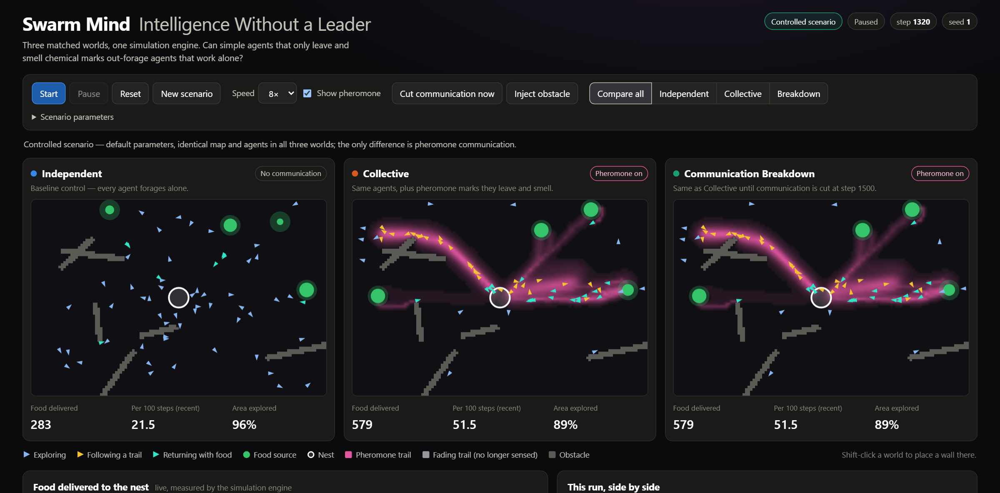
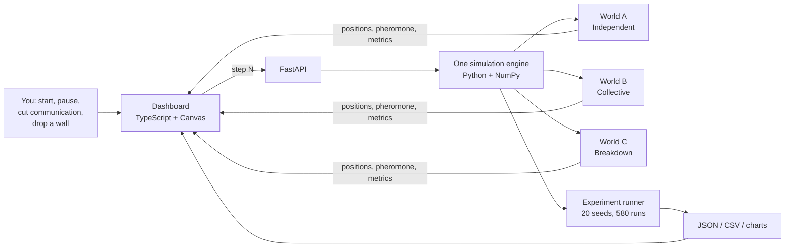
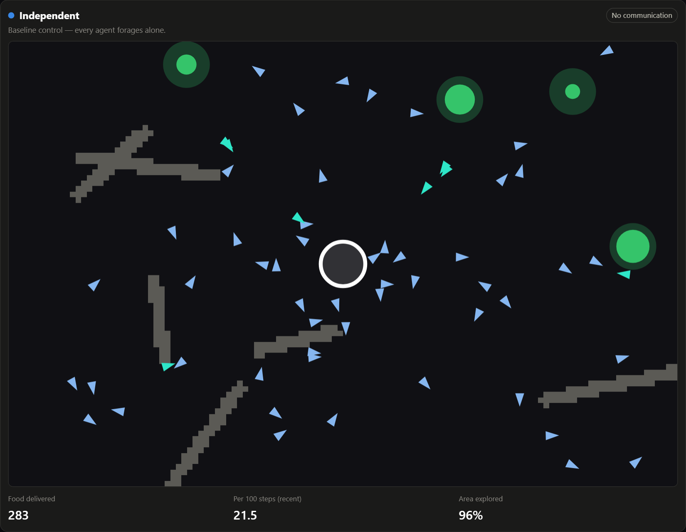
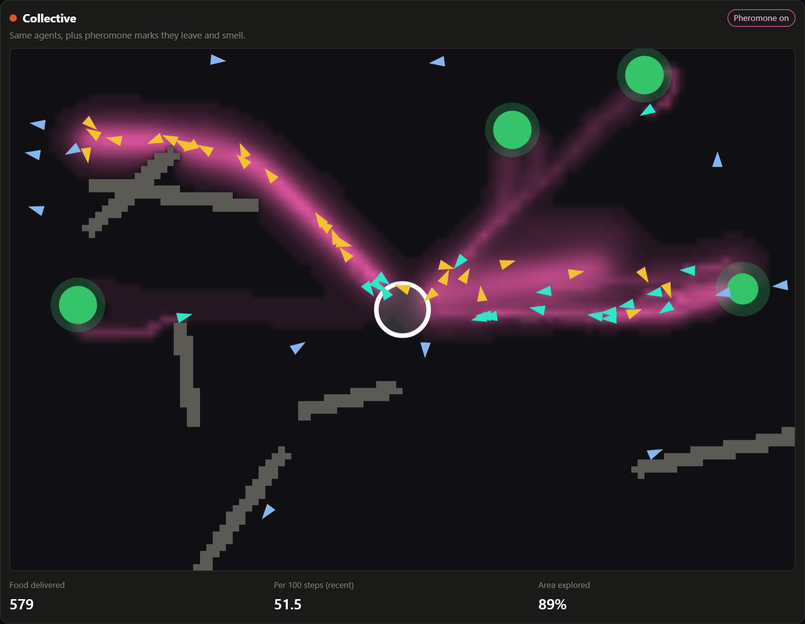
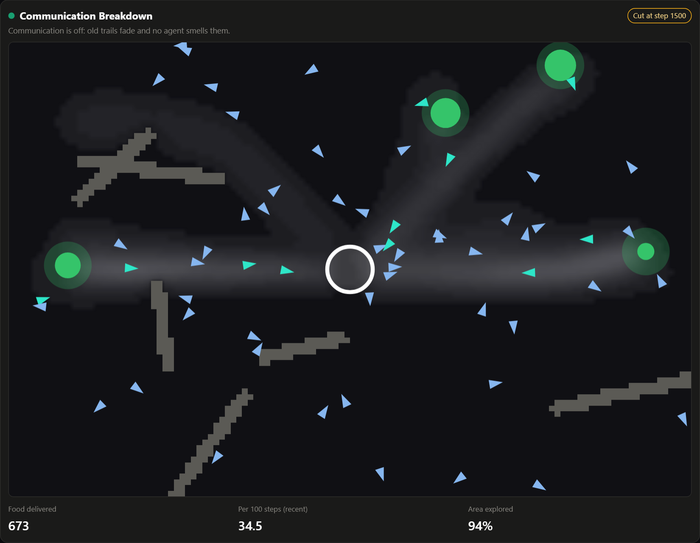

# Swarm Mind — Intelligence Without a Leader

**A small, fully reproducible simulation that asks whether agents who only leave and smell chemical marks can out-forage agents who work alone — and measures the answer instead of assuming it.**



*A real capture of the running dashboard at step 1,320 (seed 1). Same map, same agents, same random seed in all three worlds. The pink trails were not drawn by anyone.*

> 🎬 **[Watch the 2-minute demo video](showcase/video/swarm-mind-demo.mp4)** — real footage, narrated, subtitled.

---

## What is this?

Sixty simulated agents leave a nest, look for food, and carry it home. They see only a few cells around themselves. There is no leader, no map, no plan.

We run that same world three times, changing exactly one thing:

| World | What changes | Scientific role |
|---|---|---|
| **A · Independent** | Nothing. Every agent forages alone. | Baseline control |
| **B · Collective** | Agents carrying food leave a pheromone mark; searching agents tend to follow marks they smell. | The communication condition |
| **C · Communication Breakdown** | Identical to B, until communication is switched off halfway through. | Intervention |

Then we count what reaches the nest.

## Why does it matter?

Ant colonies find food, build trails and reroute around obstacles although no ant knows the plan. The trick is **stigmergy**: individuals change the environment (a drop of pheromone), and the changed environment steers other individuals. Communication is indirect, local, and nobody is in charge.

It is easy to make a pretty animation of this. It is harder to show, with a fair control group and many random seeds, that the communication is what makes the difference — and to say honestly where it stops helping. That is what this project does.

**The research question:** *Can indirect local communication improve collective problem-solving and environmental adaptation compared with independent agents?*

## How does it work?



Each step, every agent does the same few things:

1. **Sense** three short "antenna" rays ahead: is the way free, how strong is the pheromone there, does it smell closer to the nest?
2. **Decide** — a searcher picks a ray at random, with probability proportional to `(k + pheromone)^n`. With no pheromone that is a plain random walk. Food in sight overrides it. A carrier follows the nest smell home.
3. **Move** one step, unless a wall is in the way.
4. **Mark** — a carrier (in a communicating world) drops pheromone, strongest right after pickup. Marks evaporate.

That is the whole model. The decision function receives only those local readings — it has no access to the map, the food list or other agents, and a test enforces this. The Python engine is the single source of truth; the browser only draws what the engine reports.

| A · Independent | B · Collective | C · just after the cut |
|---|---|---|
|  |  |  |

More detail: [architecture](docs/architecture.md) · [experiment design](docs/experiment-design.md).

## Research foundations

The model is *inspired by* three classic works. It does not reproduce any of them.

| Paper | What we took from it |
|---|---|
| Deneubourg, Aron, Goss & Pasteels (1990). *The self-organizing exploratory pattern of the Argentine ant.* J. Insect Behavior 3(2), 159–168. [doi:10.1007/BF01417909](https://doi.org/10.1007/BF01417909) | Trail-laying plus trail-following as simple individual rules that self-organize into collective structure; the `(k + c)^n` choice function. |
| Dorigo, Maniezzo & Colorni (1996). *Ant System: optimization by a colony of cooperating agents.* IEEE Trans. SMC-B 26(1), 29–41. [doi:10.1109/3477.484436](https://doi.org/10.1109/3477.484436) | Positive feedback through pheromone reinforcement, evaporation, probabilistic choice, distributed computation. **Not** an Ant System implementation and not a TSP benchmark. |
| Reynolds (1987). *Flocks, herds and schools: a distributed behavioral model.* SIGGRAPH '87, 25–34. [doi:10.1145/37402.37406](https://doi.org/10.1145/37402.37406) · [author's page](https://www.red3d.com/cwr/papers/1987/boids.html) | Conceptual only: global patterns from local rules. No Boids engine is included. |

What each paper showed, what we simplified, and which experiment touches which idea: [docs/research-foundations.md](docs/research-foundations.md).

## What we tested

Twenty random seeds, 3,000 steps each, 580 simulation runs in total. Every world in a seed shares map, food, agents and random stream.

| # | Experiment | Question |
|---|---|---|
| 1 | Baseline food collection | Does communication change how much food is delivered? |
| 2 | Trail emergence | Does traffic concentrate onto shared routes? |
| 3 | Communication failure | What happens after the pheromone channel is cut? |
| 4 | Dynamic obstacle | Does the group recover when a wall drops across its route? |
| 5 | Multiple seeds | Do the answers hold across 20 scenarios? |
| 6 | Sensitivity | **When does communication stop helping?** |

## What we learned

All numbers below are means over 20 seeds from [`experiments/results/summary.json`](experiments/results/summary.json). Intervals are bootstrap 95% intervals of the seed-paired difference. No significance tests are claimed.


**1. In this simulation, communication more than doubled food delivery.** Collective: 1,279 units. Independent: 561. Difference +718 (interval +681 to +757), higher in 20 of 20 seeds.

**2. Trails emerged, and they are measurable.** The busiest 5% of cells carried 57% of all agent traffic in the collective world against 17% for independent agents (even traffic would give 5%).

**3. When communication was cut, the advantage went away.** In the second half, the cut world delivered 302 units — close to the independent world's 275, far from the uninterrupted swarm's 654. The swarm did not collapse; it fell back to roughly independent performance.

**4. A new wall hurt both groups, and neither fully recovered.** Late-run delivery was 86% of the pre-wall rate in both worlds. The collective swarm dipped harder at first (80%) and partly recovered; independent agents did not recover at all. The wall makes routes permanently longer, so "full recovery" was never on the table.

**5. Communication is not a free win.** This is the finding we would least want to hide:


- If pheromone evaporates very fast (20% per step), the advantage shrinks to **+13%**.
- If food keeps moving (10 units per site), it shrinks to **+33%**: trails keep pointing at empty sites.
- If trails **never** evaporate *and* food keeps moving, the communicating swarm did **4% worse** than independent agents (interval −47 to −3 units; better in only 5 of 20 seeds). Stale information is worse than none.
- Communication also slightly *reduced* exploration (98.5% vs 99.2% of the map visited): followers explore less.

Full tables, all charts and the interpretation: [docs/results-and-limitations.md](docs/results-and-limitations.md).

## Limitations and transparency

> **Research & Transparency**
>
> Swarm Mind is a research-inspired Proof of Concept built using synthetic simulation environments and locally implemented agent-based rules.
>
> No Large Language Model is used for agent control, collective decision-making, simulation, or experimental evaluation.
>
> The project explores selected concepts from self-organization, stigmergy, and decentralized coordination.
>
> Its results describe the behavior of this specific simulated system under controlled conditions, not a general proof of intelligence or a validation of biological behavior.
>
> The implementation intentionally simplifies the original research models, and these simplifications are documented.
>
> LLM integration is an optional future extension and is not required for the project's scientific purpose.

The things most worth knowing before trusting the numbers:

- **All data is synthetic.** The maps, agents and food are generated from a seed. The measurements are real measurements *of this simulation*, nothing more.
- **Every agent gets a "nest smell".** All three worlds share an idealized homing cue (walking distance to the nest, sensed at the antenna tips). It makes the trip home easy for everyone, so the experiment isolates *finding* food, not navigating home.
- **The baseline has no private memory.** An independent agent that remembered where it last found food would be a stronger control. We did not test that, and it would likely narrow the gap.
- **The parameters were chosen by us**, not fitted to any ant species or tuned by an optimizer. The sensitivity sweep shows the headline number moves a lot with them.
- **Effect sizes look enormous** because a deterministic simulation has little noise. They say the effect is consistent here, not that it is large in nature.

## Run it locally

Requires only Docker.

```bash
docker compose up --build
```

Open **http://localhost:8080**, press **Start**. (Port taken? `SWARM_WEB_PORT=8090 docker compose up --build`.)

```bash
docker compose ps        # both services should be "healthy"
docker compose logs      # server logs
docker compose down      # stop; nothing is deleted
```

Re-run the full experiment (about 5 minutes; rewrites `experiments/results/`):

```bash
docker compose exec api python -m app.experiments.run
```

Development without Docker: [docs/local-development.md](docs/local-development.md).

## Testing

| Suite | What it covers | Result |
|---|---|---|
| Backend unit, integration, scientific integrity (pytest) | Movement, perception limits, pickup, delivery, pheromone, evaporation, cut-off, metrics, reproducibility, API, fairness of the three worlds | 56 passed |
| Frontend unit (Vitest) | Payload decoding, "undefined is not zero" formatting | 5 passed |
| Browser end-to-end (Playwright, real Chromium, desktop + mobile) | Loading, controls, keyboard, settings, interventions, charts vs backend, console and network errors | 28 passed |
| Docker smoke test | Clean build, health, session, intervention, experiment in container | passed |

Among the integrity tests: World B with pheromone strength 0 must be *bit-for-bit identical* to World A, and World C must be identical to World B up to the step of the cut. Details and limits of the testing: [docs/testing.md](docs/testing.md).

## Demo video

[`showcase/video/swarm-mind-demo.mp4`](showcase/video/swarm-mind-demo.mp4) — 1 min 59 s, 1080p, English narration and burned-in subtitles ([SRT](docs/demo-video/captions-en.srt)). Screen recordings of the live dashboard plus the charts above; every number spoken is read from `summary.json` at build time. Script, storyboard, licensing and validation: [docs/demo-video/](docs/demo-video/).

## Possible extensions

Not built, deliberately: a memory-equipped baseline; a second "explorer" pheromone; parameter fitting against published ant data; an optional LLM layer that *explains* a run in plain language (never one that controls agents).

## Repository map

```text
backend/      Python simulation engine, API, experiment runner, tests
frontend/     TypeScript dashboard, unit tests, Playwright tests, capture tools
experiments/  configs/ (what was run) and results/ (what came out)
docs/         overview, architecture, research, design, results, testing, video
showcase/     real screenshots and the demo video
scripts/      smoke test and video build
```

*Part of a small series of research demonstrations: Butterfly World Model · Artificial Life · Causal Universe · **Swarm Mind**.*
