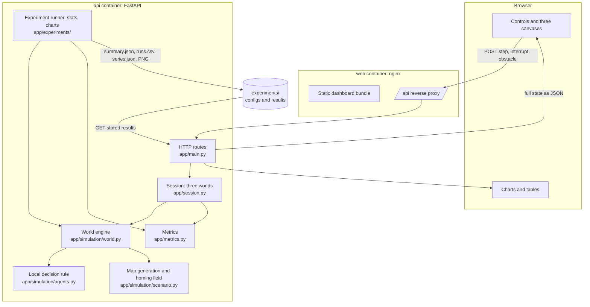

# Architecture

Two containers, one engine, no database.

## Components and their boundaries

| Component | Responsibility | Must not do |
|---|---|---|
| `simulation/agents.py` | The decision rule: local observations in, new headings out. | See the world object, the map, the food list or other agents. A test inspects its signature and source. |
| `simulation/world.py` | Holds complete state, builds each agent's local observation, moves agents, handles pickup, delivery, pheromone, interventions. | Contain any per-world special cases. The three worlds are the same class. |
| `simulation/scenario.py` | Builds the map from the seed: walls, food sites, nest-distance field. | Depend on the world mode. |
| `config.py` | One frozen parameter object. `world_overrides()` lists the only fields allowed to differ between worlds. | — |
| `metrics.py` | Definitions of every reported metric. | Return 0 for an undefined value. Undefined is `None`. |
| `session.py` | Three worlds stepped in lock-step for the dashboard; serialization. | Simulate anything itself. |
| `experiments/` | Multi-seed runs, descriptive statistics, charts, result files. | Use different engine code than the dashboard. |
| `main.py` | HTTP routes. | Contain simulation logic. |
| `frontend/` | Draw the state it receives; send user actions. | Decide anything about agent behaviour. |

## Data flow for one frame

1. The browser posts `{"n": k}` to `/api/session/{id}/step`. `k` is the speed setting (1, 2, 4 or 8).
2. The server advances all three worlds by exactly `k` fixed steps and returns the full state: agent positions, headings and behaviour labels, food, walls (bit-packed), the pheromone field (one byte per cell), metrics, the delivery curve and the event log.
3. The browser stores the state and redraws. Between two server states it interpolates agent positions so motion looks smooth at the display's refresh rate.

**Rendering speed cannot change the outcome.** A slow browser sends fewer requests per second, so the simulation advances more slowly in wall-clock time, but each step is the same step. `test_step_batching_does_not_change_the_outcome` checks that 120 single steps and two batches of 50 and 70 give identical state.

## The local simulation logic

Per step, in this order: scheduled interventions, draw random numbers, observe, decide, move, deliver, pick up, deposit, evaporate.

**What an agent can sense**

- Three rays of length 3 cells at −0.6, 0 and +0.6 rad from its heading. For each ray: is it free of walls along its whole length; pheromone at the tip; nest scent at the tip. A ray that hits a wall reports nothing beyond it.
- A food source, if its edge is within 4 cells and the line of sight is clear.

**How it decides**

- *Searching:* choose one free ray with probability proportional to `(0.1 + pheromone)^2`; turn 0.4 rad toward it; add a small random wobble. If food is seen, head straight for it.
- *Carrying:* choose the free ray with the lowest nest scent.
- *All rays blocked:* turn roughly around.

**The nest scent — the one non-local ingredient.** Every agent in every world can smell, at its antenna tips, the walking distance to the nest (a shortest-path field computed around walls, recomputed if a wall is added). It stands in for the homing abilities real foragers have and that we chose not to model. It is a strong assumption: it effectively gives every agent a good route *home*. It gives no information about where *food* is. Because all three worlds share it, it cannot explain differences between them.

**Pheromone.** One number per cell. A carrier adds `deposit × exp(−steps since pickup / 60)` to its cell, so trails are strongest near food. Each step the field loses 1%, 5% of each cell's difference to its four neighbours is evened out, and values are capped at 10.

**Randomness.** Each world owns its generator, seeded from the scenario seed. A fixed number of random values is drawn per step regardless of mode, so matched worlds stay on the same random stream. There is no global random state.

## API

| Method and path | Purpose |
|---|---|
| `GET /api/health` | Liveness. |
| `GET /api/defaults` | Default parameters, limits, and the per-world differences. |
| `POST /api/session` | Create three matched worlds (`seed`, `agent_count`, `deposit`, `interruption_step`). |
| `GET /api/session/{id}` | Current state. |
| `POST /api/session/{id}/step` | Advance `n` steps (1–200). |
| `POST /api/session/{id}/interrupt` | Cut communication in World C now. |
| `POST /api/session/{id}/obstacle` | Insert the same wall in all three worlds (default position, or at `x`,`y`). |
| `POST /api/experiments/quick` | Run a small fresh multi-seed comparison. |
| `GET /api/experiments/results` | The stored full experiment. |

## Design trade-offs

| Decision | Why | Cost |
|---|---|---|
| Plain request/response instead of WebSockets | One code path, trivially testable, the client naturally applies back-pressure. | One HTTP round-trip per frame; fine on localhost, wasteful over a slow network. |
| Server-side simulation | A single authoritative implementation shared by dashboard and experiments. | The dashboard needs the server; it is not a static page. |
| NumPy-vectorized agents | A 3,000-step run takes about a second, so 580 runs take minutes. | Code reads as array operations rather than "one ant at a time". |
| Full state every frame | Stateless client, no diffing bugs. | About 45 KB per frame. |
| Sessions in memory, capped at 16 | No database. | Sessions vanish on restart; the oldest is dropped when full. |
| No authentication | Local demonstration. | Do not expose the port to an untrusted network. |
| Matplotlib inside the API image | The documented experiment command also produces the charts. | A larger image. |
| Containers run as root | Simplest way to write results to the bind-mounted `experiments/` folder on every host OS. | Not hardened; acceptable for a local demo only. |
