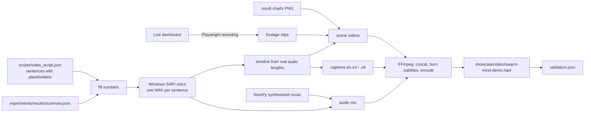

# Video production method

The video is built by a script, not edited by hand, so it can be regenerated and every element traced to its source.



## Steps

1. **Record footage.** `frontend/tools/record-footage.mjs` opens the dashboard in Chromium through Playwright with screen recording at 1920×1080, selects the view, presses Start and records 30 seconds per shot. It writes the clips and a manifest (step range, usable start time, crop rectangle measured from the page).
2. **Fill the script.** `scripts/build_video.py` loads the sentence templates and inserts numbers read from `summary.json`. If the stored results no longer match the wording about sensitivity (for example, if the "worse" condition were no longer worse), the build stops instead of narrating something untrue.
3. **Narrate.** Each sentence is synthesized separately with the offline Windows voice; leading and trailing silence is trimmed.
4. **Time.** Scene and cue times are computed from the actual audio durations: 0.7 s lead-in per scene, 0.35 s between sentences, 0.8 s tail. Subtitles are generated from the same sentences and the same times, which is why they are synchronized by construction.
5. **Render scenes.** Clips are trimmed, optionally cropped to one world's panel, and scaled into the top 930 pixels of a 1920×1080 frame. Charts are scaled into the same area. In the results scene each chart stays on screen while its sentences are spoken. The bottom 150 pixels stay empty for subtitles.
6. **Music.** A bed of the exact total duration is synthesized (see [music-license.md](music-license.md)).
7. **Mix.** Narration is placed at its cue times; music is set 21 dB below the narration's RMS level; the mix is peak-normalized to −1 dBFS.
8. **Encode.** FFmpeg concatenates the scenes, burns the subtitles in (Segoe UI, white with a thin outline, bottom band), adds short fades, and encodes H.264 (yuv420p, CRF 20) with AAC audio and `faststart` for web playback.
9. **Validate.** The script probes the result, decodes it completely, extracts two frames per scene and measures subtitle pixels in the band, and writes `showcase/video/validation.json`.

## Tools

| Tool | Use | License / cost |
|---|---|---|
| Playwright (bundled Chromium) | Screen recording of the real app | Open source, free |
| FFmpeg 9.0 | Trim, scale, concatenate, subtitles, encode | Open source, free |
| Windows SAPI via PowerShell | Narration | Included with Windows; see licensing note |
| NumPy | Music synthesis, audio mixing | Open source, free |
| Pillow | Title and closing cards | Open source, free |

No paid service and no AI image, video, voice-cloning or music generation service was used.

## Rebuild

```bash
docker compose up --build -d
cd frontend && node tools/record-footage.mjs ../build/footage && cd ..
python scripts/build_video.py
```

Narration requires Windows with PowerShell 7 and the "Microsoft Zira Desktop" voice (or pass `--voice`). On another operating system the narration step needs to be replaced; everything else is portable.

## What is and is not "real" in the video

| Element | Status |
|---|---|
| Simulation footage | Real screen recordings of the running application. |
| Charts | Real output files of the experiment runner. |
| Spoken and subtitled numbers | Read from `summary.json` at build time. |
| Title and closing cards | Composed graphics: text over blurred real screenshots. |
| Voice | Synthetic (text-to-speech). |
| Music | Synthetic (generated by the build script). |
