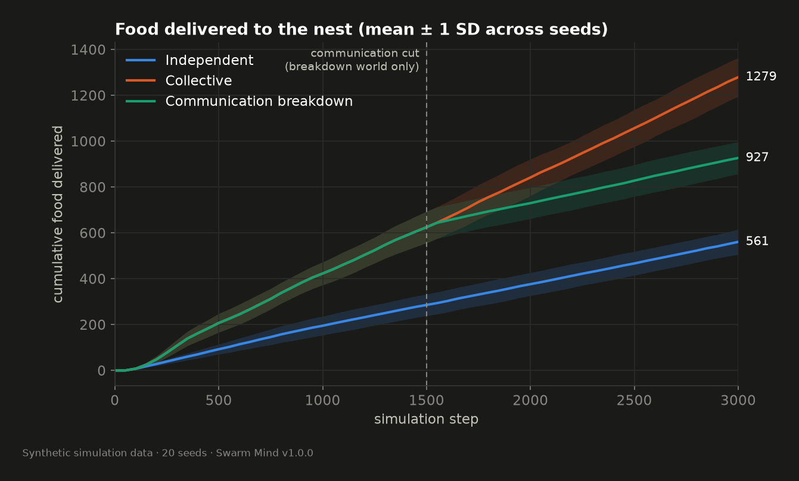
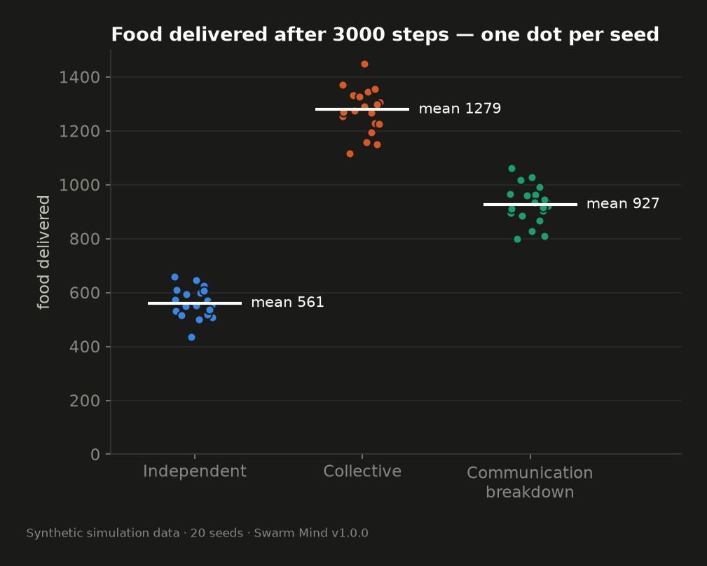
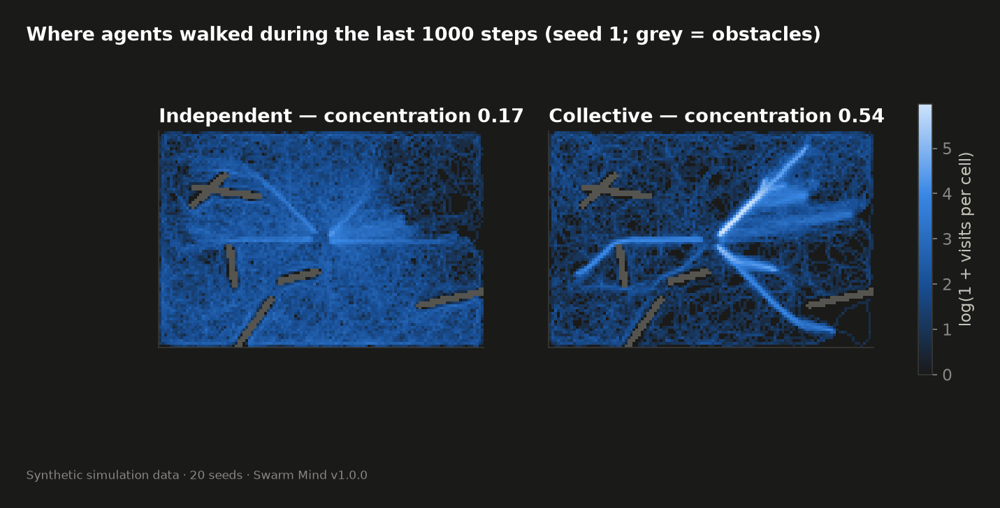
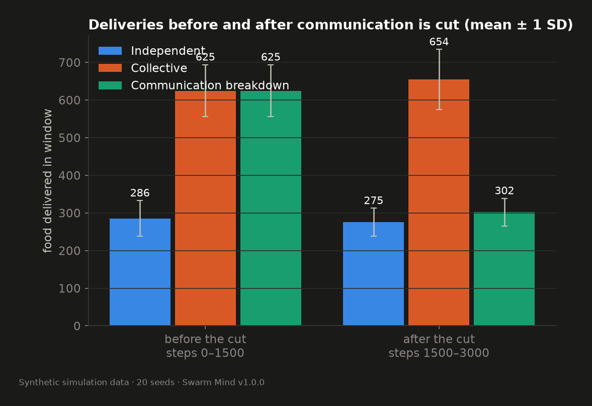
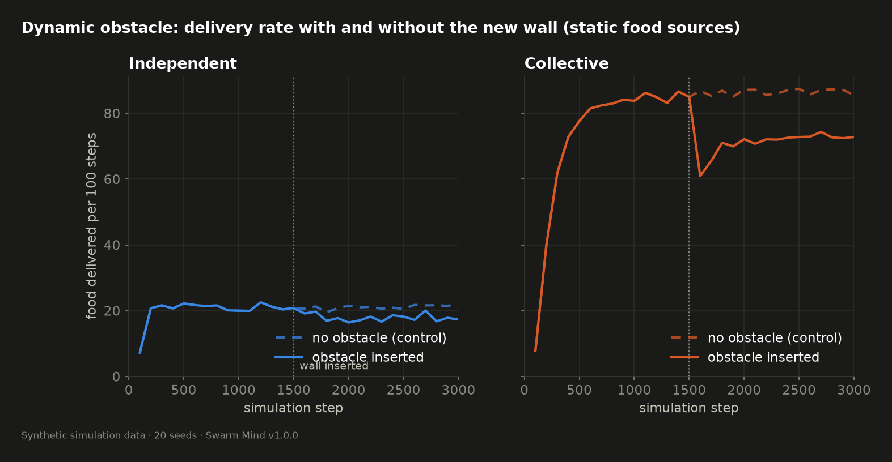
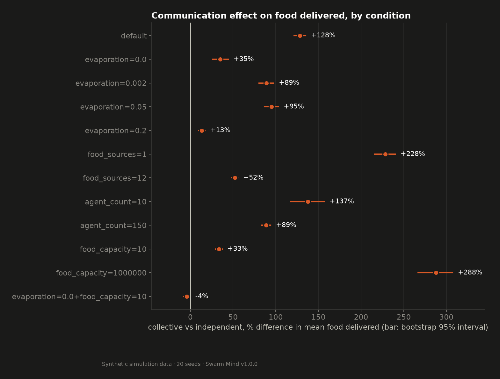

# Results and limitations

Everything here was produced by `python -m app.experiments.run` inside the `api` container and is stored in [`experiments/results/`](../experiments/results/):

| File | Content |
|---|---|
| `summary.json` | Manifest (config, seeds, versions, platform) and all aggregate statistics |
| `runs.csv` | One row per run (580 rows) with every metric and a state hash |
| `series.json` | Mean and SD of the cumulative delivery curve per condition, every 50 steps |
| `*.png` | The charts shown below |

Run details: simulator v1.0.0, 20 seeds (1–20), 3,000 steps, 580 runs, Python 3.12, NumPy 2.4.2, Linux container. **All data is synthetic.** Values are mean ± SD over seeds. "Interval" is the bootstrap 95% interval of the seed-paired mean difference. Definitions: [experiment-design.md](experiment-design.md).

## Experiment 1 — Baseline food collection

| Metric | Independent (baseline) | Collective | Difference (B − A) | Interval | Relative | B higher in |
|---|---|---|---|---|---|---|
| Food delivered | 560.8 ± 54.6 | 1279.2 ± 84.2 | +718.4 | +681.0 to +757.2 | +128% | 20/20 |
| Delivery rate per 100 steps | 18.7 ± 1.8 | 42.6 ± 2.8 | +23.9 | +22.7 to +25.2 | +128% | 20/20 |
| Travel efficiency | 0.287 ± 0.030 | 0.640 ± 0.035 | +0.353 | +0.338 to +0.367 | +123% | 20/20 |
| Exploration coverage | 0.992 ± 0.005 | 0.985 ± 0.004 | −0.008 | −0.011 to −0.004 | −0.8% | 4/20 |
| First delivery (step) | 66.3 ± 10.9 | 66.3 ± 10.9 | 0 | 0 to 0 | 0% | 0/20 |

Medians for food delivered: 552 and 1,282. Ranges: 434–659 and 1,115–1,450. The two distributions do not overlap.

**Reading it.**

- Under default conditions the communicating swarm delivered about 2.3 times as much food. The effect appeared in every seed.
- Efficiency explains most of it: independent agents spent roughly 29% of their walking on trips that were strictly needed for their deliveries; collective agents 64%. Less time is spent searching.
- **Negative finding:** communication slightly reduced exploration. Agents that follow trails cover a little less ground. The difference is small (under one percentage point) but consistent (16 of 20 seeds).
- **Null finding, by construction:** first-delivery time is identical. No pheromone exists before the first pickup, so the two worlds are the same simulation until then. This is a check on fairness, not a discovery.

## Experiment 2 — Trail emergence

| | Independent | Collective | Difference | Interval | B higher in |
|---|---|---|---|---|---|
| Traffic on the busiest 5% of cells | 0.170 ± 0.014 | 0.567 ± 0.073 | +0.396 | +0.367 to +0.429 | 20/20 |

Perfectly even traffic would give 0.05.

**Reading it.** In the collective world more than half of all agent positions fell on one twentieth of the map. The heat map shows why: narrow corridors between nest and food. No code places those corridors; an integrity test additionally checks that the pheromone field of one map does not fit another map's food layout.

The baseline is 0.17 rather than 0.05 because independent carriers also share return routes (they all follow the same nest scent) and because agents start at the nest. The metric is therefore a measure of concentration, of which trail-following is one cause.

Whether a structure is "recognizable" is a visual judgement; the metric quantifies concentration, not shape.

## Experiment 3 — Communication failure

| Window | Independent | Collective | Breakdown |
|---|---|---|---|
| Before the cut, steps 0–1500 | 285.6 ± 47.2 | 624.8 ± 69.1 | 624.8 ± 69.1 |
| After the cut, steps 1500–3000 | 275.2 ± 37.2 | 654.4 ± 80.0 | 302.0 ± 36.7 |

| Comparison, after the cut | Difference | Interval | Relative | Higher in |
|---|---|---|---|---|
| Breakdown − Collective | −352.4 | −382.3 to −321.0 | −54% | 0/20 |
| Breakdown − Independent | +26.8 | +0.6 to +50.4 | +10% | 17/20 |

**Reading it.**

- Before the cut, Breakdown and Collective are not merely similar: their delivery curves are identical in all 20 seeds (`pre_interruption_trajectories_identical: true`). The post-cut gap between them therefore starts from a common state.
- After the cut, the Breakdown world delivered less than half of what the uninterrupted swarm delivered over the same steps, in every seed.
- It did not collapse. It kept delivering at about the independent rate.
- It was slightly *above* the independent world (+27 units). **We do not attribute this to anything specific.** At the moment of the cut the two worlds differ in where agents are, how many are already carrying food, and which food sites are depleted. Agents concentrated near food at the cut would produce a head start of this size. The interval's lower end is close to zero. This experiment cannot separate those explanations.

## Experiment 4 — Dynamic obstacle

Static food sources (capacity 1,000,000); wall inserted at step 1500 in 20 of 20 seeds for both worlds.

Deliveries per 500-step window:

| World | Arm | Before (1000–1500) | Right after (1500–2000) | End (2500–3000) |
|---|---|---|---|---|
| Independent | no wall | 104.9 ± 23.2 | 103.7 ± 23.4 | 108.5 ± 22.3 |
| Independent | wall | 104.9 ± 23.2 | 89.9 ± 20.7 | 89.2 ± 19.7 |
| Collective | no wall | 426.0 ± 64.5 | 431.3 ± 64.6 | 432.8 ± 68.6 |
| Collective | wall | 426.0 ± 64.5 | 339.6 ± 55.9 | 365.2 ± 64.9 |

| World | Immediate ratio (right after ÷ before) | Recovery ratio (end ÷ before) | Same ratio without a wall |
|---|---|---|---|
| Independent | 0.86 ± 0.10 | 0.85 ± 0.09 | 1.04 ± 0.11 |
| Collective | 0.80 ± 0.10 | 0.86 ± 0.10 | 1.02 ± 0.04 |

Wall versus matched no-wall run, end window: independent −19.4 (interval −23.5 to −15.4); collective −67.6 (interval −88.3 to −47.1).

**Reading it.**

- **Hypothesis H4 was not supported.** Neither world returned to its pre-wall delivery rate within 1,500 steps.
- The collective swarm lost more at first (to 80%) and regained part of it (to 86%). Agents did find routes around the wall — deliveries continued and partly recovered — but the new routes are longer, so a lasting loss is expected rather than a failure to adapt.
- Independent agents showed no recovery at all (86% then 85%). They have nothing to re-form; the wall simply makes their trips longer.
- In absolute terms the collective swarm remained far ahead after the wall (+797 deliveries over steps 1500–3000, interval +735 to +860).
- The pre-wall windows of the wall and no-wall arms are identical, as they must be.

Caveats specific to this experiment: the nest scent is recomputed instantly when the wall appears, so agents never have to *discover* that the old way home is blocked — only searchers following a now-blocked trail are misled. A model without that shortcut would probably show a deeper dip. And with static food the collective advantage is much larger (pre-wall 426 vs 105) than in Experiment 1, so the two experiments' absolute numbers should not be compared.

## Experiment 5 — Multiple seeds

Every figure in this document aggregates 20 seeds. No seed was excluded, and no run produced an undefined metric. The seed shown by default in the dashboard and in the screenshots (seed 1) is one of the twenty and is not special.

## Experiment 6 — When does communication stop helping?

Food delivered, collective versus independent, 20 seeds each:

| Condition | Independent | Collective | Difference | Interval | Relative | B higher in |
|---|---|---|---|---|---|---|
| default | 560.8 | 1279.2 | +718.4 | +681.0 to +757.2 | +128% | 20/20 |
| evaporation = 0 (never fades) | 560.8 | 756.5 | +195.8 | +147.3 to +248.4 | +35% | 20/20 |
| evaporation = 0.002 | 560.8 | 1060.3 | +499.6 | +452.1 to +546.5 | +89% | 20/20 |
| evaporation = 0.05 | 560.8 | 1092.6 | +531.9 | +487.2 to +577.6 | +95% | 20/20 |
| evaporation = 0.2 | 560.8 | 635.1 | +74.4 | +53.5 to +94.5 | +13% | 18/20 |
| food sources = 1 | 180.6 | 592.7 | +412.1 | +390.4 to +433.4 | +228% | 20/20 |
| food sources = 12 | 1205.0 | 1833.7 | +628.7 | +586.6 to +670.0 | +52% | 20/20 |
| agents = 10 | 104.8 | 248.8 | +144.1 | +123.7 to +164.3 | +137% | 20/20 |
| agents = 150 | 1401.3 | 2646.1 | +1244.8 | +1170.5 to +1317.2 | +89% | 20/20 |
| food capacity = 10 (food moves often) | 586.4 | 781.5 | +195.2 | +174.5 to +217.8 | +33% | 20/20 |
| food capacity = 1,000,000 (food never moves) | 618.5 | 2398.4 | +1779.8 | +1651.5 to +1900.1 | +288% | 20/20 |
| **evaporation = 0 and food capacity = 10** | 586.4 | 561.0 | **−25.4** | −46.5 to −3.2 | **−4%** | **5/20** |

Evaporation does not affect the independent world, which is why its column repeats.

**Reading it.**

- The advantage depends on how well pheromone tracks reality. It is largest when food stays put (+288%) and smallest when food moves quickly (+33%).
- Evaporation has a sweet spot. Too fast (20% per step) and trails vanish before anyone can use them (+13%). None at all and old trails accumulate (+35%).
- **The combination of permanent trails and moving food reversed the effect.** The communicating swarm did slightly worse than agents with no communication, in 15 of 20 seeds. Followers are led to sites that were emptied long ago. This is the clearest answer this project has to "under which conditions does communication fail".
- The effect is modest (4%) and the interval's upper end (−3.2) is close to zero. It is safest to read it as "no advantage, probably a small disadvantage" in that condition. This variant was added after seeing the first results (see experiment-design.md), so treat it as exploratory.
- The relative advantage is smaller when food is easy to find anyway (12 sources: +52%) and larger when it is scarce (1 source: +228%).
- More agents means a smaller relative gain (+89% at 150) but a larger absolute one.

## Answers to the research questions

| Question | Answer from this simulation |
|---|---|
| Primary: can indirect local communication improve collective problem-solving and adaptation? | Problem-solving: yes under most tested conditions, substantially. Adaptation: only partly — see obstacle and moving-food results. |
| 1. Shared trails? | Yes; traffic concentration 0.57 vs 0.17. |
| 2. Better food collection? | Yes under defaults (+128%); condition-dependent. |
| 3. Behaviour when communication is disrupted? | Falls to roughly independent performance; no collapse. |
| 4. Adaptation to change? | Partial. Continued delivery around a new wall with incomplete recovery; reduced benefit when food moves. |
| 5. When does it fail? | Fast evaporation (benefit nearly gone); no evaporation with moving food (slightly harmful). |

## Limitations

**Of the model**

- An idealized, shared, instantly updated nest-scent field gives all agents near-perfect homing. Real foragers do not have this. It is the largest departure from decentralization in the project.
- Agents never collide or crowd; any number can stand in one cell. Congestion, which limits real trails, is absent.
- Only carriers deposit, and only one pheromone exists.
- Agents have no memory. A baseline with private memory was not tested and would likely narrow the gap in Experiment 1.
- Space, time and "units of food" are arbitrary. Nothing is calibrated to a real system.

**Of the experiments**

- Default parameters were hand-picked. Experiment 6 shows the headline effect ranges from −4% to +288% depending on them, so "+128%" is a property of the defaults, not a general constant.
- Sensitivity was explored one parameter at a time (plus one pair). Interactions are largely untested.
- One map size, one map style, one run length.
- Twenty seeds give stable means here because noise is low; they do not make the scenarios representative of anything beyond this generator.
- No significance tests; intervals are bootstrap intervals over seeds.
- Experiment 3's comparison with the independent world is confounded by differing world states at the cut.
- Results were generated in the Linux container. Host and container agreed on all delivery counts in a 58-run check, but floating-point state differed in the last bits, so bit-identical cross-platform results are not guaranteed.

**Of the claims**

- These results describe this simulator. They do not validate ant behaviour, do not benchmark Ant System, and do not demonstrate intelligence.
- Route optimality (do trails follow shortest paths?) was not measured.
